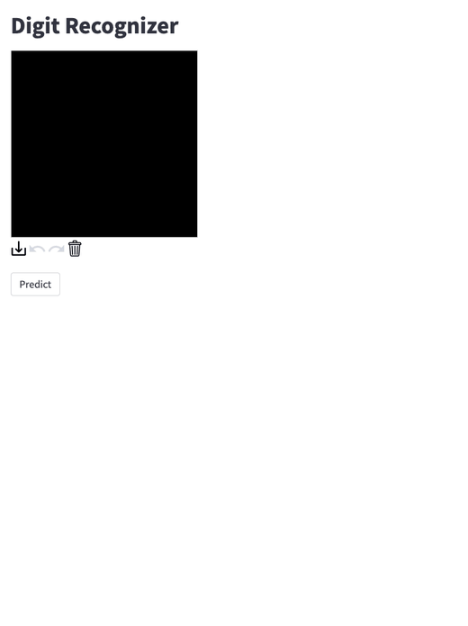

# MNIST Digit Recognizer

A small end-to-end machine learning app: draw a digit (0–9) in your browser and a convolutional neural network trained on MNIST predicts which number you wrote.



Built as the foundation project for [the ML Institute](https://ml.institute). The model is deliberately simple; the point is the full path from training a model, to serving it behind an API, to using it from a web frontend, with every prediction logged to a database.

## What it does

1. You draw a digit on a 280×280 canvas in a Streamlit web app.
2. When you click **Predict**, the drawing is converted to grayscale, resized to 28×28 (the MNIST input size) and sent to a FastAPI backend.
3. The backend runs the image through a PyTorch CNN, saves the prediction to PostgreSQL and returns the predicted digit with a confidence score.
4. You enter the digit you actually drew and click **Submit** to save it as the true label.
5. A history table shows your 50 most recent predictions and their true labels, read from the database.

## How it works

```
┌──────────────────────┐   POST /predict    ┌──────────────────────┐
│  Streamlit frontend  │  28×28 pixel array │   FastAPI backend    │
│     app/app.py       │ ─────────────────▶ │    model/api.py      │
│                      │ ◀───────────────── │                      │
│  drawing canvas,     │ digit + confidence │  PyTorch CNN         │
│  results, history    │                    │  (mnist_cnn.pth)     │
└──────────────────────┘                    └──────────┬───────────┘
                                                       │ SQLAlchemy
                                            ┌──────────▼───────────┐
                                            │      PostgreSQL      │
                                            │  predictions table   │
                                            └──────────────────────┘
```

### The model

`MNISTNet` (`model/model.py`) is a small two-layer convolutional network:

| Layer | Details |
|---|---|
| Conv2d | 1 → 32 channels, 3×3 kernel, ReLU |
| Conv2d + MaxPool | 32 → 64 channels, 3×3 kernel, 2×2 max pool, ReLU |
| Dropout2d + MaxPool | 2×2 max pool, ReLU |
| Linear | 2304 → 100, ReLU, dropout |
| Linear | 100 → 10, log-softmax |

It is trained by `model/train.py` for 10 epochs with SGD (learning rate 0.01, momentum 0.5, batch size 64). Inputs are normalised with the standard MNIST mean and standard deviation (0.1307, 0.3081). The script prints accuracy on the 10,000-image MNIST test set when training finishes and saves the weights to `model/mnist_cnn.pth`, where the backend loads them from.

### The API

| Endpoint | Description |
|---|---|
| `POST /predict` | Body: `{"image": <28×28 nested list of floats in [0, 1]>, "true_label": <optional int>}`. Saves the prediction and returns `{"id": int, "prediction": int, "confidence": float}`. |
| `PATCH /predictions/{id}` | Body: `{"true_label": <int 0–9>}`. Saves the true label for an earlier prediction. |
| `GET /history` | Returns the 50 most recent predictions, newest first. |

While the backend is running, interactive API docs are at http://localhost:8000/docs.

### The database

Each prediction is one row in the `predictions` table: `id`, `timestamp` (UTC), `predicted_digit` and `true_label` (empty until you submit it). The table is created by `db/init.sql` under Docker, and by the backend on startup if it doesn't exist yet.

## Running it with Docker

You need [Docker](https://docs.docker.com/get-docker/) with Docker Compose.

```bash
git clone https://github.com/alexrdavidson/mnist_digit_recognizer.git
cd mnist_digit_recognizer
docker compose up --build
```

Open http://localhost:8501, draw a digit and click **Predict**.

This starts three containers: PostgreSQL (`db`), the FastAPI backend (`model`, on port 8000) and the Streamlit frontend (`app`, on port 8501). Predictions are kept in a Docker volume, so they survive restarts. To change the database name, user or password, copy `.env.example` to `.env` and edit it before the first `docker compose up`.

## Running it without Docker

### Prerequisites

- Python 3.10 or 3.11 (the pinned numpy 1.24 has no builds for 3.12 or later)
- PostgreSQL running locally

### 1. Create the database

```bash
createdb mnist_predictions
export DATABASE_URL=postgresql://<your-postgres-user>@localhost:5432/mnist_predictions
```

The backend creates the `predictions` table when it starts.

### 2. Start the backend

```bash
cd model
python3 -m venv venv
source venv/bin/activate
pip install -r requirements.txt
uvicorn api:app --port 8000
```

The trained weights (`model/mnist_cnn.pth`) are included. To retrain them, run `python train.py` in the same folder. It downloads MNIST into `MNIST_data/` on the first run.

### 3. Start the frontend

In a second terminal:

```bash
cd app
python3 -m venv venv
source venv/bin/activate
pip install -r requirements.txt
streamlit run app.py
```

Open http://localhost:8501. The frontend looks for the backend at `http://localhost:8000` by default. You can change that in the sidebar or with the `API_URL` environment variable.

### Calling the API directly

```bash
curl -X POST http://localhost:8000/predict \
  -H "Content-Type: application/json" \
  -d "{\"image\": $(python3 -c 'print([[0.0]*28]*28)')}"
```

## Project structure

```
.
├── app/                  # Streamlit frontend
│   ├── app.py            # Drawing canvas, prediction display, history table
│   ├── Dockerfile
│   └── requirements.txt
├── model/                # Model and FastAPI backend
│   ├── model.py          # MNISTNet CNN definition
│   ├── train.py          # Training and test-set evaluation
│   ├── inference.py      # Helpers for loading the model and predicting
│   ├── api.py            # FastAPI app: /predict, /predictions/{id}, /history
│   ├── database.py       # SQLAlchemy model and PostgreSQL connection
│   ├── mnist_cnn.pth     # Trained model weights
│   ├── Dockerfile
│   └── requirements.txt
├── db/init.sql           # Creates the predictions table in the Postgres container
├── docker-compose.yml    # Runs the database, backend and frontend together
├── .env.example          # Database settings for docker-compose
└── docs/demo.gif         # The demo recording above
```

## Tech stack

- **Model:** PyTorch, torchvision
- **Backend:** FastAPI, Uvicorn, SQLAlchemy, PostgreSQL
- **Frontend:** Streamlit, streamlit-drawable-canvas
- **Deployment:** Docker, Docker Compose

## License

[MIT](LICENSE)
